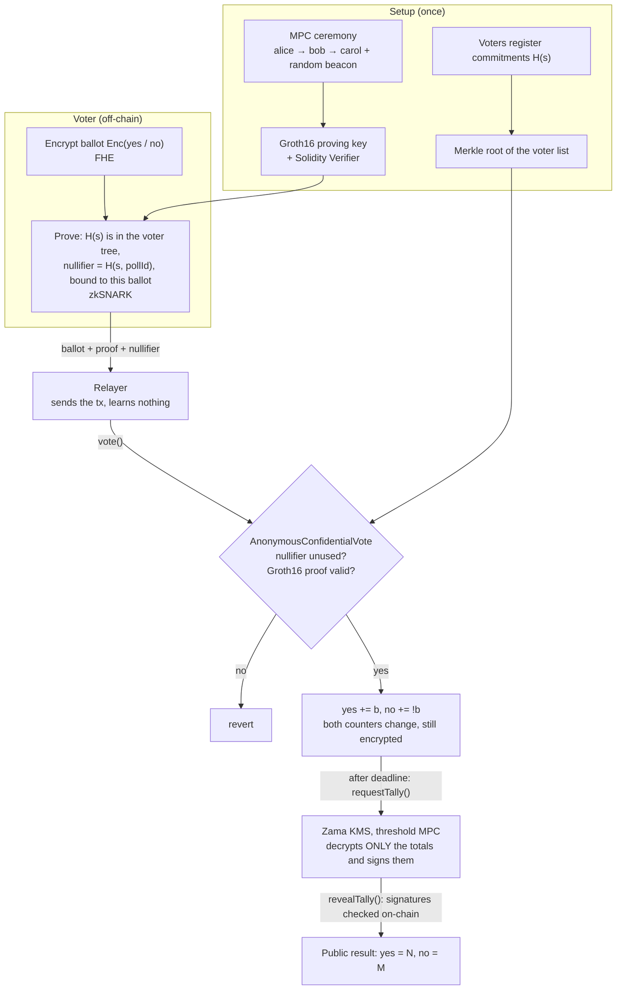

# zk-fhe-mpc-voting

[Demo](#demo) · [How it works](#how-it-works) · [Technologies](#technologies) · [Protections](#protections) ·
[Quick start](#quick-start-mock-mode-no-real-fhe-needed) · [Local CLI](#local-cli-walkthrough) ·
[Sepolia](#sepolia-real-fhe-via-the-zama-coprocessor) · [License](#license)

A yes/no vote where nobody learns **how** anyone voted or **which** registered voter cast a ballot, built from three
privacy techniques that each solve one part of the problem:

- **zkSNARK** ([gnark](https://github.com/Consensys/gnark), Groth16): the voter proves they are on the voter list
  without revealing which entry they are.
- **FHE** ([Zama FHEVM](https://docs.zama.ai/protocol)): ballots are encrypted on the client and tallied on-chain
  **under encryption**; only the final totals are ever decrypted.
- **MPC**: the Groth16 keys come from a multi-party trusted-setup ceremony, and the FHE key is held as threshold shares
  by the Zama KMS.

## Demo

`npm run test:e2e` end to end: MPC ceremony, deploy, 100 anonymous encrypted ballots, rejected double vote, tally.

[](https://asciinema.org/a/1272424)

## How it works



## Technologies

| Technology                       | Where                                   | What it hides or guarantees                                                     | Trust assumption                                                 |
| -------------------------------- | --------------------------------------- | ------------------------------------------------------------------------------- | ---------------------------------------------------------------- |
| **MPC #1**: trusted setup        | `zkvote ceremony` (gnark `mpcsetup`)    | Nobody holds the Groth16 "toxic waste", which would let them forge voter proofs | **At least one** ceremony participant discarded their randomness |
| **MPC #2**: threshold decryption | Zama KMS (part of FHEVM, not this repo) | Nobody holds the FHE private key                                                | Fewer than _t_ of _n_ KMS operators collude                      |
| **zkSNARK** (gnark, Groth16)     | `zk/circuit`, generated `Verifier`      | _Who_ voted: proves membership in the voter list without saying which entry     | None beyond MPC #1; the proof itself reveals nothing             |
| **FHE** (Zama FHEVM)             | `EncryptedTally`                        | _How_ each person voted: ballots are tallied encrypted, only totals decrypted   | Fewer than the threshold of KMS operators collude                |

Note the two different MPC trust models: the ceremony is safe if **1 of N** participants is honest, while the KMS is
safe if **fewer than _t_** operators are dishonest.

### The trusted-setup ceremony

Groth16 needs secret randomness to build its keys, and whoever knows it can forge proofs. The ceremony splits it across
participants: each one loads the previous state, mixes in fresh randomness and forgets it. Every contribution carries a
proof that it builds on the previous one, and a public random beacon seals each phase.

```bash
npm run zk:build
zk/bin/zkvote ceremony init                           # phase 1 (powers of tau) starts
zk/bin/zkvote ceremony contribute --phase 1 --name alice
zk/bin/zkvote ceremony contribute --phase 1 --name bob
zk/bin/zkvote ceremony seal --phase 1 --beacon "<value nobody knew in advance>"
zk/bin/zkvote ceremony contribute --phase 2 --name alice   # phase 2: specific to the vote circuit
zk/bin/zkvote ceremony contribute --phase 2 --name bob
zk/bin/zkvote ceremony seal --phase 2 --beacon "<another beacon value>"
zk/bin/zkvote ceremony verify                         # anyone can replay the transcript and check the keys
```

`npm run zk:setup` runs all of this with alice, bob and carol. The transcript is `zk/build/ceremony/transcript.json`;
sealing phase 2 writes `zk/build/vote.pk`, `zk/build/vote.vk` and the Solidity verifier `contracts/zk/VoteVerifier.sol`.
In this demo all participants run on one machine, so it shows the protocol, not the trust: a real ceremony has
independent people contributing from their own machines.

The circuit's Merkle tree has depth 10, so a poll holds up to **1024 voters** (`Depth` in `zk/circuit/circuit.go`). The
number of ceremony participants is unlimited. Changing the depth changes the circuit, so its keys no longer fit;
`npm run zk:ensure` (run by `npm test` and `test:e2e`) fingerprints the circuit and repeats the ceremony when needed.

## Protections

Each attack below is covered by `test/AnonymousConfidentialVote.ts`.

| Attack                                            | Defence                                                                                                          |
| ------------------------------------------------- | ---------------------------------------------------------------------------------------------------------------- |
| Unregistered voter                                | The proof must reach the contract's `voterRoot`                                                                  |
| Voting twice                                      | `nullifier = MiMC(secret, pollId)` is the same every time and is stored as used                                  |
| Voting twice with `nullifier + p`                 | The generated verifier rejects public inputs that are not reduced modulo the BN254 field                         |
| Ballot stuffing (Enc(1000))                       | The ballot type is `ebool`, so its value can only be 0 or 1                                                      |
| Front-runner copies the proof with its own ballot | The proof is bound to the ballot handle (`ballotHash`); the handle is bound to the sender by the FHE input proof |
| Reusing a proof in another poll                   | `pollId` is the contract address and is a public input                                                           |
| Relayer changes the vote                          | It cannot: the ballot is encrypted and the proof is bound to it                                                  |
| Peeking at running totals                         | The totals are not decryptable by anyone until `requestTally()`, which only works after the deadline             |
| Forged result                                     | `FHE.checkSignatures` verifies the KMS signatures on-chain                                                       |

### Not covered

- **Voter registration.** The demo generates every identity in one file (`zk/build/voters.json`). In reality each voter
  generates their own secret with `zkvote identity` and hands only the commitment to the registrar.
- **Network-level privacy.** The relayer sees the voter's IP and timing unless the voter connects through Tor or a
  similar mixnet.
- **Coercion and vote buying.** A voter can still prove how they voted by revealing their secret and encryption
  randomness.
- **Small electorates.** If everyone votes the same way, or only one person votes, the totals reveal individual votes.
- **Quantum adversaries, partly.** Privacy holds: ballots are LWE-based FHE ciphertexts, and Groth16 proofs are
  perfectly zero-knowledge over MiMC commitments, so data harvested today reveals neither votes nor voters later.
  Integrity does not: Groth16 on BN254, the KMS signatures and Ethereum accounts all rely on elliptic curves, so a
  quantum computer available _during_ a poll could forge membership proofs or the result. Replacing Groth16 with a
  hash-based proof system (e.g. a STARK) would remove the trusted setup as well.

## Quick start (mock mode, no real FHE needed)

Requires Node 20+ and Go 1.26+.

```bash
npm install
npm test           # contract tests; builds zkvote and runs the demo ceremony first if the keys are missing
npm run zk:test    # Go tests for the circuit
npm run test:e2e   # end to end on a local node: fresh ceremony, deploy, 100 voters via the CLI, tally
E2E_VOTERS=1024 npm run test:e2e   # the full voter-tree capacity
npm run zk:clean                   # delete keys, ceremony transcript, verifier and the zkvote binary
```

## Local CLI walkthrough

`deploy` creates five voter identities in `zk/build/voters.json` (`VOTER_COUNT` changes that) and registers their
commitments as the voter root. Every ballot is submitted by the relayer account, so the chain never sees a voter's
address.

```bash
# terminal 1
npx hardhat node

# terminal 2
DURATION_SECONDS=60 npx hardhat --network localhost deploy
npx hardhat --network localhost task:vote --support yes --voter 0
npx hardhat --network localhost task:vote --support no  --voter 1
npx hardhat --network localhost task:vote --support yes --voter 2
npx hardhat --network localhost task:vote --support no  --voter 2   # reverts: NullifierAlreadyUsed
npx hardhat --network localhost task:vote-batch --from 3            # the remaining voters in one go
npx hardhat --network localhost task:status         # totals are opaque handles
npx hardhat --network localhost task:advance-time --seconds 60
npx hardhat --network localhost task:tally          # Result: yes=2 no=1
```

## Sepolia (real FHE via the Zama coprocessor)

```bash
npx hardhat vars set MNEMONIC
npx hardhat vars set INFURA_API_KEY
DURATION_SECONDS=600 npx hardhat --network sepolia deploy
npx hardhat --network sepolia task:vote --support yes --voter 0
# ...wait for the deadline...
npx hardhat --network sepolia task:tally
```

## License

BSD-3-Clause-Clear (inherited from the Zama template). See [LICENSE](LICENSE).
